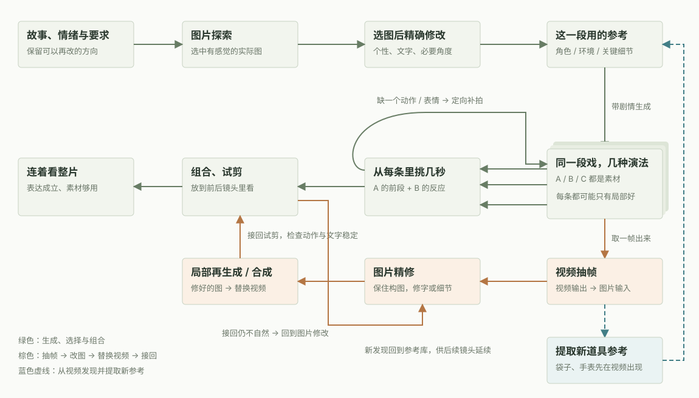
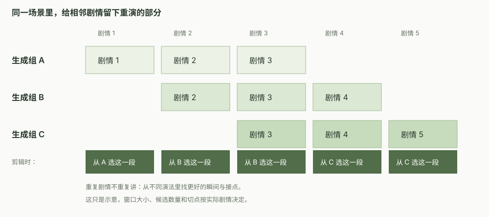

# AIGC 视频制作里的摩擦与洞察

从真实制作中的截图、例子和判断出发，讨论 AIGC 视频、品牌广告与剧情短片为什么容易卡住，以及人和 AI 怎样配合。

## 两个阅读入口

- **给人阅读的网页：[打开在线版本](https://xwen111.github.io/aigc-production-insights/)**
- **给 AI 的完整手册：[AI_PLAYBOOK.md](AI_PLAYBOOK.md)**

网页以六类摩擦点组织内容，配有原始实测截图、素材关系网和重叠生成图解。AI 手册保留同样的情境和洞察，另外写清执行规则、容易误解的地方和素材之间需要记录的关系。

当前版本 **v4.0**：34 条洞察，包含完整保留的 32 条复盘和 2 条明确标记的补充建议；对应最初讨论的 39 个要点。13 张原始截图均已保留。

## 从这些问题开始看

1. **有图，却没感觉**：东西画齐了，为什么仍没有“记忆中的夏天”？人物为什么太完美反而不真实？
2. **哪些东西要单独备**：主角、路人、手机、狗牌，什么时候才需要成为独立参考？
3. **空间和动作怎么接**：猫头鹰进演播厅、网球撞墙、握手后拍背，为什么不宜把所有画面先画死？
4. **多生成怎样有用**：同词并行和重叠剧情各自解决什么问题，怎样给剪辑留空间？
5. **怎么看、怎么挑**：如何从几条不完美的素材里，各取最好的几秒？
6. **好镜头怎样救回来**：卷尺数字、纸面公式、时钟表盘错了，怎样局部修好再接回去？

## 素材是怎样来回流动的



- **局部修复**：视频 → 抽帧 → 图片修改 → 局部再生成或合成 → 替换视频 → 接回剪辑；不自然时继续修改。
- **新参考**：视频里出现合适的袋子或手表 → 提取为参考 → 继续后续镜头。
- **各取所长**：同段剧情多次生成 → 每条选几秒 → 组合试剪 → 缺什么再补什么。



生成 1/2/3、2/3/4、3/4/5，是让相同剧情有不同演法和可匹配的接点。剪辑不重复讲重叠剧情，而是在不同版本里选择。实际窗口按场景、连续事件和模型限制调整。

## 文件怎么用

| 文件 | 用途 |
| --- | --- |
| [index.html](index.html) | 网页入口，也可直接在本地浏览器打开 |
| [AI_PLAYBOOK.md](AI_PLAYBOOK.md) | 供 AI 理解和执行的完整手册 |
| [frictions.json](frictions.json) | 分类、洞察、案例及旧要点的结构化对应 |
| [assets/](assets/) | 原始截图、阅读裁切图和说明性 SVG |
| [tools/](tools/) | 内容源与重建脚本 |
| [VERIFICATION.md](VERIFICATION.md) | 内容与页面检查记录 |

## 更新与重建

编辑 `tools/notes.py` 的洞察，或 `tools/topics.py` 的分类。然后运行：

```bash
python3 tools/build.py
```

构建会更新网页、AI 手册、JSON 和两张关系图，保留 README。构建只使用 Python 标准库。阅读用的裁切图片已经包含；只有重新裁图时才需要 Pillow 和 `tools/prepare_crops.py`。

本地预览：

```bash
python3 -m http.server 8765 --bind 127.0.0.1
```

浏览器打开 `http://127.0.0.1:8765/`。发布使用 GitHub Pages，来源为 `main` 分支根目录；后续推送后自动更新在线网页。

## 关于这份记录

它来自创作者与 AI 对具体制作案例的深入复盘。第一人称为口述整理，不是逐字稿。模型表现按这些案例理解；补充建议单独标记。不同项目截图不构成同一部影片，关系图是方法说明。本仓库没有原始视频，也没有声称验证动态成片或实际生成费用。
